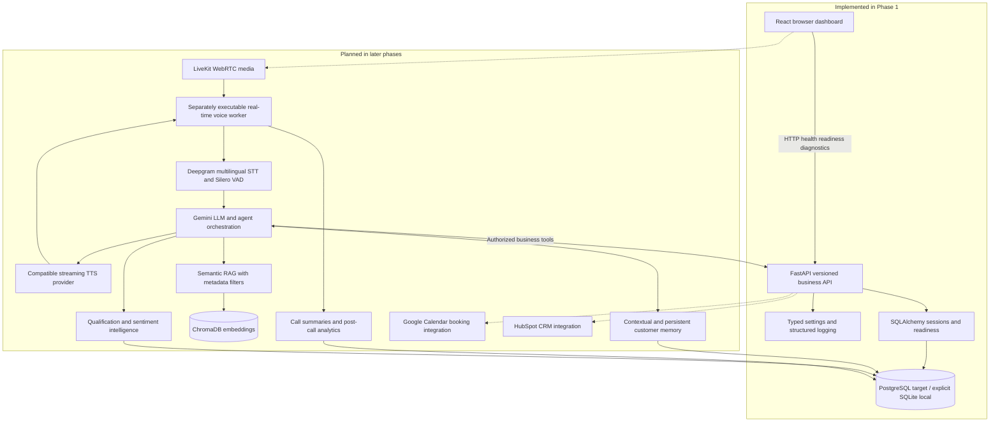

# Architecture and engineering decisions

Phase 3 adds canonical property/unit prices in SQLite and narrative chunks in persistent ChromaDB. Ingestion embeds approved knowledge files, stores model identity on the collection, and skips unchanged documents. Queries embed with the same model; SQL unit filters decide budget and availability before retrieved property passages can be presented. The LiveKit agent's tools call this same service from a worker thread with a timeout. Documents are untrusted evidence and cannot override agent instructions.

Phase 2 adds the separately executable LiveKit worker and a minimal voice session table. The voice path is implemented but has not been exercised with real provider credentials. Health is process liveness; readiness executes SQL `SELECT 1`; development diagnostics only checks credential presence, never provider reachability.

## Phase 2 voice path

Browser microphone → LiveKit WebRTC room → dispatched Python worker → Silero VAD → Deepgram Nova-3 streaming STT → Gemini 2.5 Flash LLM with per-call context → ElevenLabs multilingual TTS → LiveKit room audio → browser playback. LiveKit text streams feed the React transcript. The browser receives only a short-lived token scoped to its unique room. The API stores consent, room/participant identifiers, state and timestamps; audio and transcripts are not stored. A local-only owner key in session storage restricts lifecycle API calls in this demo. The worker caps room lifetime at 600 seconds and updates database state when its session starts or ends. LiveKit's built-in interruption handling is enabled. Provider and microphone behaviour has not been measured or manually verified.

WebRTC carries low-latency media. A LiveKit room contains the browser and worker as participants. Silero marks speech activity, Deepgram streams recognized words, Gemini uses the session's conversation history, and ElevenLabs streams the spoken reply. Turn detection decides when the user has finished speaking; barge-in interrupts a speaking agent. The worker runs asynchronously so audio processing does not block the FastAPI business API. Client tokens grant joining one room, publishing/subscribing media and no room administration or data publishing.

The current UI shows LiveKit agent state and real transcripts, including interim/final status where text-stream attributes provide it. It does not claim browser playback latency, STT accuracy, interruption success or English/Hindi/Hinglish quality without actual calls. Structured customer memory belongs to Phase 3. External business integrations remain future work.

The browser knows only a public API URL. Provider secrets stay on the backend/worker. No AI SDKs are installed before compatibility is established. Synchronous SQLAlchemy routes execute in FastAPI's thread pool rather than blocking the async event loop. Each request owns its session; lifespan owns the engine and disposal. Connection timeout is bounded, and a database failure never selects another database silently. Alembic owns future schema changes; no `create_all` runs at startup.

## Planned data model

| Entity | Future responsibility |
|---|---|
| Customers | Identity, language preference, consent and durable preferences |
| Leads | Structured qualification, score and sales ownership |
| Conversation sessions | Lifecycle, language, consent and provider references |
| Conversation messages | Speaker, content, ordering and timestamps |
| Appointments | Customer, property, UTC slot and external event ID |
| Call summaries | Generated summary, outcomes and review state |
| Agent events | Tool decisions, failures and redacted audit trail |
| Integration sync records | Idempotency key, attempts and external IDs |
| Knowledge documents | Provenance, property metadata, version and embedding references |

No business tables are implemented yet. Use timezone-aware UTC timestamps. Later booking tools must collect and confirm the customer's timezone, convert Asia/Kolkata local appointment times with Python `zoneinfo`, and persist UTC plus the original zone. Do not store naive local timestamps.

## Complete Phase 1 workflow

Developer starts API with explicit database choice → browser concurrently requests health/readiness/diagnostics → API runs a lightweight SQL query → dashboard renders real backend/database status and configuration booleans → developer stops/restarts a service and refreshes to observe failure and recovery. This verifies the foundation end to end; a complete *sales* workflow is a later deliverable.

## Security and privacy

Development defaults bind loopback, use explicit CORS, omit raw errors, and ignore credentials/audio databases/build artifacts. Diagnostics returns 404 outside development. Credential presence is not validity or authorization. Do not put real customer data in this unauthenticated foundation. Before a public pilot, add authentication, per-workspace authorization, HTTPS, managed secrets, encrypted storage/backups, consent and recording disclosure, retention/deletion controls and auditable integration access. Redact personal information from logs; limit audio/transcript collection to consented business needs. Production security controls are planned, not delivered by these development containers.

## Scale and infrastructure strategy (planning assumptions)

100,000 registered users does not mean 100,000 simultaneous calls. Initial capacity planning assumes 1% active at once (1,000 browser sessions), 10% of active users in a live call (100 concurrent voice sessions), and two ordinary API requests per active browser per minute (~33 requests/s before bursts). Voice session count and provider rate limits dominate cost and throughput. Measure actual traffic and revise assumptions before sizing.

Start with one managed PostgreSQL instance, stateless API processes behind HTTPS and a separately deployed voice worker pool. Use managed LiveKit media or validated equivalent. Bound SQL pools per process and keep total connections below database limits. Scale voice workers from CPU/session benchmarks and provider quotas; distribute Chroma carefully or evaluate a managed vector store only when deployment requirements justify it. Use object storage for consented audio, pagination and indexed queries for business records. Keep integration retries durable with idempotency records; do not add queues/frameworks before the workload establishes a need. Load testing, failure recovery and autoscaling are future work.

Local infrastructure is Docker Compose with a persistent PostgreSQL volume and readiness dependencies. Future deployment: build pinned images, run migrations as a release step, use a managed database with backups, HTTPS ingress, secret management, separate environments, monitoring and rollback. No hosting is provisioned in this phase.

## Commercial feasibility and operational cost model

The proposed product reduces repetitive buyer intake and increases follow-up coverage. A pilot should measure qualified-lead accuracy, completed consented conversations, site-visit conversion, human handoff and cost per qualified lead. Human sales staff remain responsible for commitments and exception handling. Commercial viability requires conversion gains to exceed voice/provider/operations cost; this is an unvalidated hypothesis.

Do not treat illustrative budgets as provider quotes. Model monthly cost as:

`voice minutes × (STT/min + TTS/min + media/min) + LLM input/output tokens + embedding tokens + API/worker compute + PostgreSQL/vector/object storage + monitoring/egress`.

For a pilot assumption of 1,000 calls × 5 minutes = 5,000 voice minutes, insert currently verified provider rates at procurement time. Engineering budget scenarios could reserve USD 100–300/month for low-volume shared compute/database/monitoring **excluding all voice/model usage**; this is a planning allowance, not a researched price. No paid resources are required for Phase 1. At 100 concurrent calls, measure worker utilization and call duration before giving a production estimate. Final commercial, infrastructure and cost analysis will be refined after provider selection and load tests.

## Compatibility references

Implementation follows [FastAPI lifespan](https://fastapi.tiangolo.com/advanced/events/), [Pydantic Settings](https://docs.pydantic.dev/latest/concepts/pydantic_settings/), [SQLAlchemy engines](https://docs.sqlalchemy.org/en/20/core/engines.html), [Tailwind Vite integration](https://tailwindcss.com/docs/installation/using-vite) and the pinned Vite 6 toolchain. Current Vite releases have different Node requirements; [Vite documentation](https://vite.dev/guide/) should be checked before upgrading. Use the committed locks to reproduce this build.
